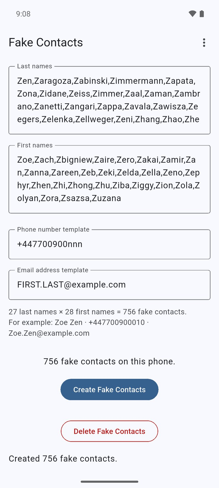

# Fake Contacts

Android phone app that creates fake contacts, which will be stored on your smartphone along with your real contacts.  This feeds fake data to any apps or companies who are copying our private data to use or sell it.  This is called "data-poisoning".

Nothing about these fake contacts will interfere with your normal use of your phone or your real contacts.

Only Android is supported, because the app keeps track of the contacts it created by their Android contact IDs.

The app is available through F-Droid.

This is a sister-application to "Fake Contacts 2", which puts fake information in some fields of all contacts.

## Functionality
The user can set lists of last names and first names for fake contacts, and phone-number and email-address templates for them.  Then click buttons to create or delete fake contacts with all combinations of the first and last names.  Below the fields, the app shows how many contacts that makes, and an example of one.  "Create" is disabled until both lists have at least one name, and the app warns when the lists would make more than 10,000 contacts.


## Use



The default values should be sensible.  All of the first and last names start with "Z", to try to keep them from colliding with names of real contacts, and to keep them out of the way (at the end of the Contacts list).  If you have changed them, "Reset to defaults" in the menu (⋮) at the top puts the name lists and templates back, after asking; the fake contacts already created are kept, and "Delete" can still remove them.  "About", in the same menu, explains what the app does and what it stores, and has its privacy policy, its version, a link to its source code and the licenses of the software it uses.

So, just install and launch the application, and click the "Create Fake Contacts" button.  The system should ask you to grant Contacts permission to the application.  Then the contacts (one for each firstname-lastname combination) will be created.  Launch your usual Contacts app and scroll to the end to see the new contacts.  Note: it may take a couple of minutes to update the list.

If you wish, click the "Delete Fake Contacts" button to delete them.  Note: it may take a couple of minutes to update the list.  You also could use your normal Contacts app to delete them manually at any time, without causing any problem.

You could uninstall this app after creating the fake contacts, without causing any problem.


### Customizing

* The list of last names is just a comma-separated list.  You can edit it to have any names.  Spaces around the commas, empty entries and duplicate names are ignored.

* The list of first names is similar.

* The phone-number template is a single value used for all contacts.  Any character "n" in it will be replaced by a digit 0-9, derived from the contact's last name.  The default format is ```+447700900nnn```, which falls in the UK range Ofcom reserves for TV and film (+44 7700 900000 to 900999), so the numbers can never belong to a real person.  (The old default, ```+2134567nnnn```, was in Algeria's country code +213; if you still have it, the app switches you to the new default automatically.)  You could delete the contents of this field if you wish, and no phone numbers will be generated.  The app warns under the field if the template has no "n" (every contact would get the same number) or characters a phone number can't have.

* The email-address template is a single value used for all contacts.  Any string "FIRST" in it will be replaced by the contact's first name.  Any string "LAST" in it will be replaced by the contact's last name.  The default format is ```FIRST.LAST@example.com```, which is intended to be an unused email domain.  You could delete the contents of this field if you wish, and no email addresses will be generated.  The app warns under the field if the template doesn't look like an email address, or if a name it uses has a space.


### Quirks

* The app is designed to be very simple.  Under the buttons, the app reports how many contacts were created/deleted (or that permission was denied; once Android no longer asks for it, a dialog offers to open the app's settings instead), so you can tell the operation finished; errors are marked with an icon.  The message stays until you tap Create or Delete again.  Since the operation loops over all firstname/lastname combinations, it may take a while to finish (about half a minute for 10,000 contacts); the buttons are disabled while it's working, and a big batch shows how far it got, with a Stop button (Back stops it too) that stops it after the current group of contacts.  With a keyboard or D-pad, the button you used has the focus again afterwards.  The app follows the phone's dark theme setting.  If the app is closed or killed partway through a Create, it still knows which contacts it made, so "Delete" can remove them.  If you click the "Create" button multiple times, you just get one set of fake contacts; if you add names to the lists, only the new combinations are created.

* "Delete" only removes contacts this app created.  When it creates contacts, the app privately records their internal IDs in its own storage (nothing is written into the contacts themselves, so other apps can't use it to filter out the fakes).  Delete removes only those recorded contacts, so a real contact that happens to have the same name as a fake one is never touched.  If Android has merged a fake contact with one of your real contacts, the app leaves that contact alone and tells you how many it skipped; you can remove the fake details by hand.

* The record of what the app created stays on this phone.  The app opts out of Android backup and phone-to-phone transfer, because the internal IDs it records are only valid on the phone that created the contacts; on another phone the same IDs can belong to your real contacts.  (So your name lists and templates aren't carried over to a new phone either.)  If you clear the app's data, uninstall it, move to a new phone, or restore your contacts from a backup (which gives them new IDs), "Delete" can no longer remove the fake contacts made before.  Delete them by hand in your Contacts app.  (Creating again won't make duplicates: contacts with exactly the same name, phone number and email address are recognised and skipped.)  The same applies to fake contacts made by versions 1.8 and earlier.

* As a second safeguard, "Delete" checks that each recorded contact still has exactly the name, phone number and email address it was created with.  Any that don't, for example a fake contact you edited, are left alone, and the message tells you how many were skipped.

* Replacements for "n" digits in phone numbers are calculated deterministicly (repeatably) from contact's last name.  So for example if 5 users of this app all just leave everything set at defaults, the same contacts will show up on each of their phones with the same names, phone numbers, and email addresses.  This is good, for data-poisoning purposes.  Further, all fake contacts with same last name will have same phone number (debatable whether this is good or bad).


---


## Releases
### 1.0.0
Got working.
### 1.6.0
Got published on F-Droid.
### 1.7.0
Changed color of delete button, added space between buttons, added a lot more names, cleaned up the code a little.
### 1.8.0
Added Spanish description to Fastlane per https://github.com/BillDietrich/fake_contacts/pull/5
### Unreleased
* Updated to current Flutter, Dart 3 and flutter_contacts; progress spinner and result messages (from https://github.com/BillDietrich/fake_contacts/pull/11).
* "Delete" now removes only contacts this app created, never real contacts with the same name.
* "Create" no longer makes duplicates.
* The app is excluded from Android backup and phone-to-phone transfer, and "Delete" checks each contact's name, phone number and email before removing it, so a record restored onto another phone can't delete real contacts.
* Default phone template moved from Algeria's +213 to the reserved UK drama range +44 7700 900xxx.
* Settings load once and save shortly after you stop typing (and when the app is backgrounded); the page scrolls on small screens; name lists wrap; Delete button is readable.


---

## Development
### To-Do list
* What Android versions are supported ?  I tested on 9; someone else says it works on 9 and crashes on 5.
* Add buttons to add/delete fake secondary info (e.g. birthday ?) on ALL contacts. Or make a separate app for that.
* Want to explicitly set Notification permission off, but there's no way to do it.
* Add photos from thispersondoesnotexist.com ?

### Tests
* `flutter test` runs the unit and widget tests.
* `tool/integration_test.sh --wipe-contacts` runs the on-device tests in `integration_test/`, which create and delete contacts through the app. The script only runs on an Android emulator, and `--wipe-contacts` empties the emulator's address book first.
* `tool/release_smoke_test.sh` builds a release APK, installs it on an emulator, starts it, and checks it doesn't crash and can read and write its settings. Release builds go through R8, which the other tests don't, and which can break plugins. It doesn't exercise contacts (the app only touches them when a button is tapped). It needs an emulator image without Play Store (for `adb root`).
* `tool/check_build_tools.sh` checks that Gradle, the Android Gradle plugin, Kotlin and `gradle.properties` match the project template of the Flutter in use, and that the Gradle download's checksum is Gradle's. Run it after a Flutter upgrade: it says what to change. `tool/test/` has tests for it and for `tool/check_flutter_release.sh`.
* CI runs all of these; the on-device tests and the smoke test run on both Android 16 (API 36) and Android 17 (API 37.0) (whose memory limits for apps the emulator doesn't set). A weekly workflow also opens an issue when a newer stable Flutter is out (`tool/check_flutter_release.sh`), and closes it once the app has moved to it.

### Development Environment
I'm no expert on this stuff, this is my first phone app, maybe I'm doing some things stupidly.

Now using:
* Android Studio
* Flutter
* Dart
* Linux
* Phone running Android 9

[F-Droid page for this app](https://fdroid.gitlab.io/fdroid-website/en/packages/me.billdietrich.fake_contacts/)

[GitHub repo for this app](https://github.com/BillDietrich/fake_contacts)

[My web site](https://www.billdietrich.me/)


---

## Privacy Policy
This application doesn't collect, store or transmit your identity or personal information in any way.  It contains no advertising and no trackers.  It has no internet access.


## License

See LICENSE.md file.  MIT license.  Copyright 2021 Bill Dietrich.
