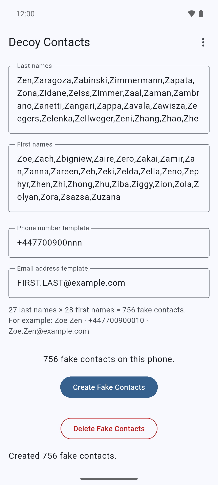

# Decoy Contacts

Based on [Fake Contacts](https://github.com/BillDietrich/fake_contacts) by Bill Dietrich.

Some apps and companies copy the contacts on your phone, to use or sell them.  Decoy Contacts adds fake contacts among your real ones, so what they copy is worth less.  This is called data poisoning.

With the default settings, the fake contacts stay out of your way:
* Their names start with Z, so they sort to the end.
* Their phone numbers are in the UK range reserved for TV and film (+44 7700 900000 to 900999), so they can't be anyone's real number.
* Their email addresses use example.com, a domain reserved for examples.

"Delete" removes only the fake contacts this app created, and only if their name, phone number and email address are still as it made them.  It never deletes your real contacts, even ones with the same name.

The app has no internet access, no ads and no trackers.  The only permission it asks you for is access to your contacts.

## Install

Decoy Contacts is an Android app, and needs Android 7.0 or newer.

Download it from the [Releases page](https://github.com/thefanciestturtle/decoy_contacts/releases).  Each release has one APK for each type of processor: `arm64-v8a` for most phones, `armeabi-v7a` for phones with a 32-bit processor, and `x86_64` for Chromebooks with an Intel or AMD processor and for emulators.  If Android says the `arm64-v8a` one isn't compatible with your phone, take the `armeabi-v7a` one.  Android may ask you to allow your browser or file manager to install apps.

To update the app, install the new version's APK, of the same type, over the old one.  The app keeps your settings and its list of the fake contacts it created.  (Don't uninstall the old one first: that deletes the list, see "Good to know" below.)

Release APKs are signed with this app's own key.  Android installs an update only if it is signed with the same key.  The SHA-256 fingerprint of its certificate is:

`7e9a346a64feba002aa3d9fe060c3a2df5f78dd1a79a56bdb1873072245f6d6c`

To check an APK you downloaded, `apksigner verify --print-certs` (from the Android SDK's build-tools) shows the fingerprint after "certificate SHA-256 digest".  Each release is built so that a build of the same source gives the same files, apart from the signature (see [DEVELOPMENT.md](DEVELOPMENT.md)).

### If you have Fake Contacts

Decoy Contacts is a separate app from Fake Contacts (version 1.8, on F-Droid), and installs next to it.  Your name lists and templates aren't carried over.  Decoy Contacts can't delete the fake contacts that Fake Contacts made, because Fake Contacts kept no record of them.  If you have some, clear them before you start using Decoy Contacts: tap "Delete Fake Contacts" in Fake Contacts (it deletes every contact with one of its names, real ones too), then uninstall it.  Or delete them by hand in your Contacts app.

## Use

1. Tap "Create Fake Contacts".
2. The first time, Android asks whether to allow the app to access your contacts.  Tap "Allow".
3. The app asks, for example, "Create 756 fake contacts?".  Tap "Create".
4. Under the buttons, the app says how many it created.  Your Contacts app lists them with your real contacts.

To remove them, tap "Delete Fake Contacts".  The app asks first, with the number it will delete.  You can also delete any of them in your Contacts app.

Once the app has access to your contacts, a line above the buttons says how many fake contacts on this phone it can delete.

The menu (⋮) at the top has "Reset to defaults" and "About".  "Reset to defaults" puts the name lists and templates back, after asking; the fake contacts already created are kept, and "Delete" can still remove them.  "About" explains what the app does and what it stores, and has its privacy policy, its version, a link to its source code and the licenses of the software it uses.

### Settings

* "Last names" and "First names" are comma-separated lists, and can have any names.  Spaces around the commas, empty entries and duplicate names are ignored.  Below the fields, the app shows how many contacts the lists make (one for each first name with each last name), and an example of one.  "Create Fake Contacts" is disabled until both lists have at least one name, and the app warns when the lists would make more than 10,000 contacts.

* The phone number template is used for every contact.  Each "n" in it becomes a digit, worked out from the contact's last name.  The default, `+447700900nnn`, is in the UK range Ofcom reserves for TV and film (+44 7700 900000 to 900999), so the numbers can never belong to a real person.  Leave the field empty for no phone numbers.  The app warns under the field if the template has no "n" (every contact would get the same number) or has characters a phone number can't have.

* The email address template is used for every contact.  "FIRST" in it becomes the contact's first name, and "LAST" the last name.  The default, `FIRST.LAST@example.com`, uses example.com, a domain reserved for examples.  Leave the field empty for no email addresses.  The app warns under the field if the template doesn't look like an email address or has no FIRST or LAST (every contact would get the same address), if a name in the lists can't be part of an address (one with a space, say), or if the longest names make an address too long to work.

The app keeps your settings: it saves them shortly after you stop typing.

### Good to know

* "Delete" only removes contacts this app created.  When it creates contacts, the app records their internal IDs in its own storage (nothing is written into the contacts themselves, so other apps can't use it to filter out the fakes).  Delete removes only those recorded contacts, and only if each still has exactly the name, phone number and email address it was created with.  Any that don't, for example a fake contact you edited, are left alone, and the message says how many.  If Android has merged a fake contact with one of your real contacts, the app leaves that contact alone too, and says so; you can remove the fake details by hand.

* The record of what the app created stays on this phone.  The app opts out of Android backup and phone-to-phone transfer, because the internal IDs it records are only valid on the phone that created the contacts; on another phone the same IDs can belong to your real contacts.  (So your name lists and templates aren't carried over to a new phone either.)  If you clear the app's data, uninstall it, move to a new phone, or restore your contacts from a backup (which gives them new IDs), "Delete" can no longer remove the fake contacts made before: delete them by hand in your Contacts app.  So to remove them with Delete, use it before you move to a new phone, clear the app's data or uninstall the app.  The same applies to the fake contacts made by Fake Contacts (see above).

* Tapping "Create Fake Contacts" again doesn't make a second set: contacts with exactly the same name, phone number and email address are recognised and skipped, even after the app's record of them is lost.  If you add names to the lists, only the new combinations are created.

* A big batch takes a while (about half a minute for 10,000 contacts).  The buttons are disabled while it runs, and the app shows how far it got, with a Stop button (Back stops it too) that stops it after the current group of contacts.  If the app is closed or killed partway through a Create, it still knows which contacts it made, so "Delete" can remove them.

* The result stays under the buttons until you tap Create or Delete again; errors are marked with an icon.  Once Android stops asking for access to your contacts (after you have refused it twice, say), the app offers to open its settings instead, where you can allow it.

* The digits for "n" are worked out from the contact's last name, the same way every time.  So if several people leave everything at the defaults, the same contacts, with the same names, phone numbers and email addresses, are on each of their phones.  That's good for data poisoning.  It also means that all fake contacts with the same last name get the same phone number.

* TalkBack reads the results.  With a keyboard or D-pad, the focus is shown, goes back to the button you used, and the arrow keys can leave a text field.  The app follows the phone's dark theme setting.

---

## Privacy Policy
This application doesn't collect, store or transmit your identity or personal information in any way.  It contains no advertising and no trackers.  It has no internet access.

## Changes

What changed in each version: [CHANGELOG.md](CHANGELOG.md).

## Development

How to build the app, run its tests and make release builds: [DEVELOPMENT.md](DEVELOPMENT.md).  To report a problem, open an [issue](https://github.com/thefanciestturtle/decoy_contacts/issues).

## The original Fake Contacts

[F-Droid page of the original Fake Contacts](https://f-droid.org/packages/me.billdietrich.fake_contacts/)

[GitHub repo of the original Fake Contacts](https://github.com/BillDietrich/fake_contacts)

[Bill Dietrich's web site](https://www.billdietrich.me/)

## License

See LICENSE.md file.  MIT license.  Copyright 2021 Bill Dietrich.
